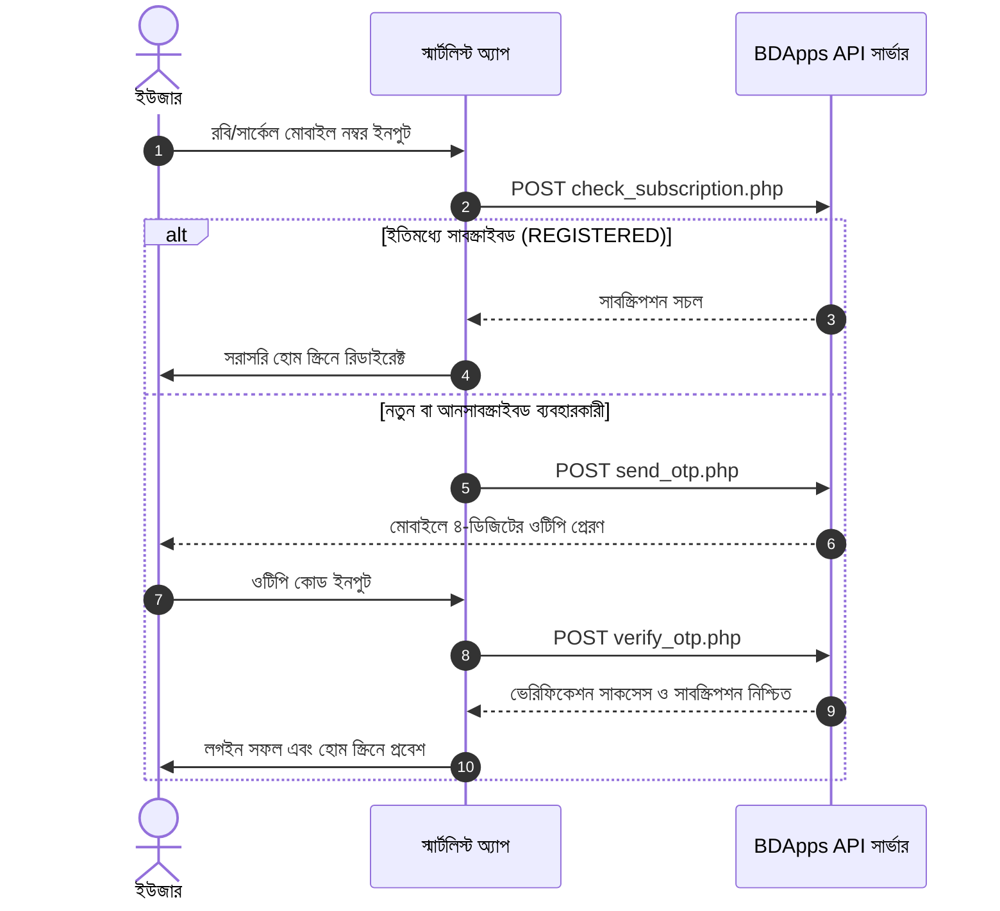

# 🛒 SmartList (বাজার তালিকা) — Project Report & Documentation

**SmartList (বাজার তালিকা)** হলো একটি সহজ, দ্রুত এবং আধুনিক অফলাইন-ফার্স্ট কেনাকাটার তালিকা (Bazar / Grocery List) এবং খরচের হিসাব রাখার মোবাইল অ্যাপ্লিকেশন। এটি বিশেষভাবে বাংলাদেশের সাধারণ ব্যবহারকারীদের দৈনন্দিন বাজারের অভিজ্ঞতা সহজ ও সুশৃঙ্খল করার জন্য তৈরি। অ্যাপটি **BDApps** প্ল্যাটফর্মের মাধ্যমে রবি (Robi) ও সার্কেল (Cirkle - সাবেক Airtel) নেটওয়ার্কের সাবস্ক্রিপশন ও ওটিপি (OTP) ভিত্তিক অথেন্টিকেশনের সাথে যুক্ত।

---

## 📌 সূচিপত্র (Table of Contents)

1. [প্রজেক্টের বিবরণ (Project Overview)](#-প্রজেক্টের-বিবরণ-project-overview)
2. [মূল ফিচারসমূহ (Key Features)](#-মূল-ফিচারসমূহ-key-features)
3. [টেকনোলজি স্ট্যাক ও লাইব্রেরিসমূহ (Tech Stack & Dependencies)](#-টেকনোলজি-স্ট্যাক-ও-লাইব্রেরিসমূহ-tech-stack--dependencies)
4. [অ্যাপ আর্কিটেকচার ও ডিরেক্টরি স্ট্রাকচার (Architecture & Directory Structure)](#-অ্যাপ-আর্কিটেকচার-ও-ডিরেক্টরি-স্ট্রাকচার-architecture--directory-structure)
5. [ডাটাবেজ আর্কিটেকচার (Database Schema & Migrations)](#-ডাটাবেজ-আর্কিটেকচার-database-schema--migrations)
6. [BDApps ও টেলকো সাবস্ক্রিপশন ফ্লো (BDApps & Telco Integration)](#-bdapps-ও-টেলকো-সাবস্ক্রিপশন-ফ্লো-bdapps--telco-integration)
7. [ল্যান্ডিং পেজ (Web Landing Page)](#-ল্যান্ডিং-পেজ-web-landing-page)
8. [ইনস্টলেশন ও রান করার নিয়ম (Setup & Run Guide)](#-ইনস্টলেশন-ও-রান-করার-নিয়ম-setup--run-guide)
9. [বিল্ড ও রিলিজ নির্দেশিকা (Build & Release Guide)](#-বিল্ড-ও-রিলিজ-নির্দেশিকা-build--release-guide)
10. [ভবিষ্যত পরিকল্পনা (Future Enhancements)](#-ভবিষ্যত-পরিকল্পনা-future-enhancements)

---

## 📖 প্রজেক্টের বিবরণ (Project Overview)

দৈনন্দিন জীবনে কাঁচাবাজার বা সুপারশপে কেনাকাটার সময় কাগজ-কলমে তালিকা তৈরি করা অথবা ফোনে হিজিবিজি নোট রাখা বেশ ঝামেলার। বাজার করার সময় কোন জিনিসটি কেনা হলো, কোনটি বাকি আছে এবং মোট কত টাকা খরচ হলো—তা তাৎক্ষণিকভাবে হিসাব রাখা অনেকের জন্য কঠিন হয়ে পড়ে।

**SmartList** এই সমস্যাগুলোর সম্পূর্ণ সমাধান প্রদান করে:

- ব্যবহারকারী একাধিক বাজারের তালিকা তৈরি ও সংরক্ষণ করতে পারেন।
- জিনিসপত্রের আনুমানিক বা আসল দাম লিখে মোট খরচের তাৎক্ষণিক হিসাব রাখা যায়।
- কেনা শেষ হলে টিকচিহ্ন দিয়ে আর্কাইভ করে রাখা যায়।
- এক ক্লিকেই সম্পূর্ণ বাজারের ফর্দ পরিবার বা বন্ধুদের কাছে হোয়াটসঅ্যাপ, মেসেঞ্জার বা এসএমএসে শেয়ার করা যায়।

---

## ✨ মূল ফিচারসমূহ (Key Features)

### ১. একাধিক তালিকা ব্যবস্থাপনা (Multiple Lists Management)

- প্রয়োজন অনুযায়ী একাধিক আলাদা তালিকা তৈরি করা যায় (যেমন: সাপ্তাহিক বাজার, মাসের সদাই, রমজানের বাজার ইত্যাদি)।
- তালিকার নাম এডিট, আর্কাইভ এবং ডিলিট করার সুবিধা।
- ড্রপডাউন থেকে খুব সহজেই এক তালিকা থেকে অন্য তালিকায় সুইচ করা যায়।

### ২. দ্রুত আইটেম যুক্তকরণ ও সম্পাদনা (Quick Add & Item Management)

- দ্রুততম সময়ে আইটেমের নাম, সম্ভাব্য মূল্য এবং ক্যাটাগরি যুক্ত করা।
- কেনা সম্পন্ন হওয়া আইটেমগুলোতে চেকমার্ক (`isBought`) দেওয়া।
- কেনা আইটেম এবং বাকি থাকা আইটেম আলাদাভাবে হাইলাইট হয়।

### ৩. স্বয়ংক্রিয় খরচ ক্যালকুলেশন (Real-time Budget Calculation)

- **মোট আনুমানিক বাজেট (Total Estimated Cost)**: তালিকায় থাকা সব পণ্যের সম্ভাব্য খরচের যোগফল।
- **কেনা বাবদ খরচ (Bought Total)**: যে পণ্যগুলো কেনা হয়েছে সেগুলোর মোট খরচ।
- **বাকি খরচ (Remaining Total)**: যে পণ্যগুলো এখনো কেনা বাকি তার আনুমানিক খরচ।

### ৪. ক্যাটাগরি অনুযায়ী ফিল্টারিং ও কাস্টম ক্যাটাগরি (Categorization)

- ডিফল্ট ক্যাটাগরি: সবজি (Vegetables), মাছ (Fish), মাংস (Meat), মসলা (Spices), অন্যান্য (Others)।
- ব্যবহারকারী চাইলে নিজের পছন্দমতো নতুন ক্যাটাগরি যুক্ত বা কাস্টমাইজ করতে পারেন।
- ক্যাটাগরিভিত্তিক দ্রুত ফিল্টারিংয়ের সুবিধা।

### ৫. সার্চ ও শর্টিং সুবিধা (Search & Sorting)

- **রিয়েল-টাইম সার্চ**: তালিকার যেকোনো পণ্য দ্রুত খুঁজে পেতে তাৎক্ষণিক সার্চ বার।
- **বহুমাত্রিক সর্টিং**:
  - নিজের মতো (Manual drag & drop / custom)
  - আগে যোগ করা (Date Ascending)
  - নতুন যোগ করা (Date Descending)
  - বর্ণানুক্রমিক (A to Z এবং Z to A)

### ৬. তালিকা শেয়ারিং (One-Tap Share)

- তালিকা ও খরচের বিবরণ সুন্দর ফরম্যাটে কপি করে বা সরাসরি WhatsApp, SMS, সোশ্যাল মিডিয়ায় পাঠানোর সুবিধা (`share_plus` প্যাকেজের মাধ্যমে)।

### ৭. আর্কাইভ ও হিস্ট্রি (Archive & History Screen)

- সম্পন্ন হওয়া বাজার তালিকাগুলো আর্কাইভে সংরক্ষণ থাকে।
- পুরনো বাজারের তারিখ ও খরচের হিসাব পরবর্তীতে দেখার সুবিধা।

### ৮. থিম ও বাংলা ফন্ট সাপোর্ট (Theme & Typography)

- ডার্ক মোড (Dark Mode) ও লাইট মোড (Light Mode) টগল অপশন, যা ডিভাইসে স্থায়ীভাবে সেভ থাকে।
- প্রফেশনাল বাংলা টাইপোগ্রাফির জন্য ব্যবহৃত হয়েছে **Tiro Bangla** ফন্ট।

### ৯. বিডিঅ্যাপস সাবস্ক্রিপশন ও অথেন্টিকেশন (BDApps Telco Login)

- রবি (Robi - 018) এবং সার্কেল (Cirkle / সাবেক Airtel - 016) সিম নম্বরের জন্য ডেডিকেটেড লগইন ভ্যালিডেশন।
- ওটিপি (OTP) ভেরিফিকেশন এবং ব্যাকএন্ড এপিআই দিয়ে সাবস্ক্রিপশন স্ট্যাটাস চেক।

---

## 🛠 টেকনোলজি স্ট্যাক ও লাইব্রেরিসমূহ (Tech Stack & Dependencies)

| ক্যাটাগরি          | টেকনোলজি / লাইব্রেরি                                                                 | বিবরণ                                             |
| :----------------- | :----------------------------------------------------------------------------------- | :------------------------------------------------ |
| **Framework**      | [Flutter](https://flutter.dev/) (SDK ^3.11.1)                                        | ক্রস-প্ল্যাটফর্ম মোবাইল অ্যাপ ফ্রেমওয়ার্ক         |
| **Language**       | [Dart](https://dart.dev/)                                                            | আধুনিক অবজেক্ট-ওরিয়েন্টেড প্রোগ্রামিং ল্যাঙ্গুয়েজ |
| **Local Database** | [`sqflite: ^2.4.2`](https://pub.dev/packages/sqflite)                                | অফলাইন-ফার্স্ট রোবাস্ট রিলেশনাল লোকাল স্টোরেজ     |
| **Preferences**    | [`shared_preferences: ^2.5.5`](https://pub.dev/packages/shared_preferences)          | ইউজার সেটিংস, থিম ও সেশন ডাটা ক্যাশিং             |
| **Networking**     | [`http: ^1.6.0`](https://pub.dev/packages/http)                                      | BDApps ব্যাকএন্ড API এর সাথে ডেটা আদান-প্রদান     |
| **Sharing**        | [`share_plus: ^13.1.0`](https://pub.dev/packages/share_plus)                         | নেটিভ ডায়ালগের মাধ্যমে তালিকা শেয়ারিং             |
| **Monetization**   | [`google_mobile_ads: ^8.0.0`](https://pub.dev/packages/google_mobile_ads)            | গুগল অ্যাডমব ইন্টিগ্রেশন সাপোর্ট                  |
| **Typography**     | `Tiro Bangla`                                                                        | প্রজেক্টের অ্যাসেটে ইন্টিগ্রেটেড বাংলা ফন্ট       |
| **Icons & Assets** | [`flutter_launcher_icons: ^0.14.4`](https://pub.dev/packages/flutter_launcher_icons) | অ্যান্ড্রয়েড ও আইওএস অ্যাপ আইকন জেনারেটর         |

---

## 📂 অ্যাপ আর্কিটেকচার ও ডিরেক্টরি স্ট্রাকচার (Architecture & Directory Structure)

```text
bazartalika_bdapps/
├── android/                   # নেটিভ অ্যান্ড্রয়েড প্ল্যাটফর্ম কনফিগারেশন
├── assets/                    # ফন্ট, লোগো এবং ইমেজ রিসোর্স
│   ├── app_icon.png
│   ├── logo.png
│   └── font/
│       ├── TiroBangla-Regular.ttf
│       └── TiroBangla-Italic.ttf
├── frontend/                  # অ্যাপের মার্কেটিং ও ডাউনলোড ল্যান্ডিং পেজ
│   ├── css/style.css
│   ├── js/script.js
│   ├── assets/
│   └── index.html
├── lib/                       # মূল ডার্ট অ্যাপ্লিকেশন সোর্স কোড
│   ├── main.dart              # অ্যাপ এন্ট্রি পয়েন্ট ও থিম ইনিশিয়ালাইজেশন
│   ├── models/                # ডেটা মডেল ও সিরিয়ালাইজেশন
│   │   ├── bazar_item.dart    # পণ্যের নাম, দাম, স্ট্যাটাস ও টাইমস্ট্যাম্প
│   │   ├── bazar_list.dart    # বাজারের তালিকা ও মেটাডাটা
│   │   └── category.dart      # পণ্যের ক্যাটাগরি মডেল
│   ├── screens/               # ইউজার ইন্টারফেস স্ক্রিনসমূহ
│   │   ├── home_screen.dart   # মূল বাজার তালিকা, ক্যালকুলেশন ও অপারেশনস
│   │   ├── login_screen.dart  # রবি/সার্কেল ওটিপি ও সাবস্ক্রিপশন স্ক্রিন
│   │   └── archive_screen.dart# পুরনো ও আর্কাইভ হওয়া তালিকার হিস্ট্রি
│   ├── services/              # ব্যাকএন্ড ও লোকাল সার্ভিসেস
│   │   └── database_helper.dart # SQLite ডাটাবেজ হেল্পার ও মাইগ্রেশনস
│   └── widgets/               # রি-ইউজেবল উইজেট
│       └── bazar_item_tile.dart # একক পণ্যের ইন্টারঅ্যাক্টিভ লিস্ট টাইল
├── pubspec.yaml               # ডিপেনডেন্সি ও অ্যাসেট কনফিগারেশন
└── README.md                  # প্রজেক্ট রিপোর্ট ও ডকুমেন্টেশন
```

---

## 🗄 ডাটাবেজ আর্কিটেকচার (Database Schema & Migrations)

অ্যাপটিতে লোকাল স্টোরেজ হিসেবে **SQLite** (`sqflite`) ব্যবহার করা হয়েছে। ডাটাবেজের নাম `bazar_talika.db` এবং বর্তমান ভার্সন **৪**।

### টেবিল স্ট্রাকচার:

#### ১. `lists` টেবিল

| ফিল্ড        | ডেটা টাইপ | কনস্ট্রেইন্ট              | বিবরণ                      |
| :----------- | :-------- | :------------------------ | :------------------------- |
| `id`         | INTEGER   | PRIMARY KEY AUTOINCREMENT | তালিকার ইউনিক আইডি         |
| `name`       | TEXT      | NOT NULL                  | তালিকার নাম                |
| `isArchived` | INTEGER   | NOT NULL DEFAULT 0        | আর্কাইভ স্ট্যাটাস (০ বা ১) |
| `createdAt`  | TEXT      | NOT NULL                  | তৈরির সময় (ISO 8601)       |

#### ২. `items` টেবিল

| ফিল্ড               | ডেটা টাইপ | কনস্ট্রেইন্ট              | বিবরণ                    |
| :------------------ | :-------- | :------------------------ | :----------------------- |
| `id`                | INTEGER   | PRIMARY KEY AUTOINCREMENT | পণ্যের ইউনিক আইডি        |
| `listId`            | INTEGER   | FOREIGN KEY (`lists.id`)  | সংশ্লিষ্ট তালিকার আইডি   |
| `name`              | TEXT      | NOT NULL                  | পণ্যের নাম               |
| `price`             | REAL      | NULLABLE                  | পণ্যের দাম               |
| `category`          | TEXT      | NULLABLE                  | ক্যাটাগরি JSON/টেক্সট    |
| `isBought`          | INTEGER   | NOT NULL DEFAULT 0        | কেনা হয়েছে কিনা (০ বা ১) |
| `isArchived`        | INTEGER   | NOT NULL DEFAULT 0        | আর্কাইভ স্ট্যাটাস        |
| `createdAt`         | TEXT      | NOT NULL                  | আপডেটের সময়              |
| `originalCreatedAt` | TEXT      | NULLABLE                  | প্রথম যুক্ত করার সময়     |

---

## 📡 BDApps ও টেলকো সাবস্ক্রিপশন ফ্লো (BDApps & Telco Integration)

অ্যাপটি রবি আজিয়াটা লিমিটেডের **BDApps** এপিআই ভিত্তিক সাবস্ক্রিপশন মডেলে কাজ করে:

- **সাপোর্টেড নেটওয়ার্ক**: রবি (`018...`) এবং সার্কেল (`016...`)।
- **দৈনিক চার্জ**: ২.৭৮ টাকা/দিন (ভ্যাট, এসডি ও এসসি সহ)।
- **এপিআই বেস ইউআরএল**: `https://bdapps.flicksize.com/smartlisting/api/`

### অথেন্টিকেশন ও ওটিপি ফ্লো:



---

## 🌐 ল্যান্ডিং পেজ (Web Landing Page)

প্রজেক্টের সাথে `frontend/` ফোল্ডারে একটি আধুনিক, রেসপন্সিভ এবং এসইও-বান্ধব ল্যান্ডিং পেজ রয়েছে:

- **টেকনোলজি**: পিওর HTML5, আধুনিক CSS3 ভ্যারিয়েবল ও ভ্যানিলা জাভাস্ক্রিপ্ট (কোনো এক্সটারনাল ডিপেনডেন্সি ছাড়া দ্রুত লোড হয়)।
- **ফিচারসমূহ**:
  - বাংলা ও ইংরেজি দ্বিভাষিক টগল (Language Switcher: BN ⇄ EN)।
  - লাইট ও ডার্ক থিম মোড সুইচ।
  - অ্যাপের সরাসরি APK ডাউনলোড লিংক (`smartlist.apk`)।
  - মোবাইল ও ডেস্কটপ উভয়ের জন্য শতভাগ রেসপন্সিভ লেআউট।

---

## 🚀 ইনস্টলেশন ও রান করার নিয়ম (Setup & Run Guide)

### ১. ক্লোন ও প্রজেক্ট ডিরেক্টরিতে প্রবেশ:

```bash
cd /Volumes/Volume1/Project/Bazar-Talika/bazartalika_bdapps
```

### ২. ডিপেনডেন্সি ইনস্টল:

```bash
flutter pub get
```

### ৩. কোড কোয়ালিটি ও অ্যানালাইসিস চেক:

```bash
flutter analyze
```

### ৪. ডেভেলপমেন্ট মোডে রান:

```bash
flutter run
```

---

## 📦 বিল্ড ও রিলিজ নির্দেশিকা (Build & Release Guide)

### অ্যাপ আইকন তৈরি (App Icons Generation):

```bash
flutter pub run flutter_launcher_icons
```

### প্রোডাকশন APK তৈরি:

```bash
flutter build apk --release
```

আউটপুট পাথ: `build/app/outputs/flutter-apk/app-release.apk`

### গুগল প্লে স্টোর / বিডিঅ্যাপস রিলিজের জন্য App Bundle তৈরি:

```bash
flutter build appbundle --release
```

আউটপুট পাথ: `build/app/outputs/bundle/release/app-release.aab`

---

## 🔮 ভবিষ্যত পরিকল্পনা (Future Enhancements)

- [ ] একাধিক ডিভাইসের মধ্যে লাইভ তালিকা সিঙ্ক (ক্লাউড ব্যাকআপ)।
- [ ] ভয়েস কমান্ডের মাধ্যমে আইটেম যোগ করার সুবিধা (Speech to Text)।
- [ ] বিগত মাসের মোট ব্যয়ের বিস্তারিত চার্ট ও গ্রাফিক্যাল বিশ্লেষণ।
- [ ] পরিবারের অন্যান্য সদস্যদের সাথে রিয়েল-টাইম সহযোগী কেনাকাটা (Collaborative Shopping)।
- [ ] বাংলা ও ইংরেজি ভাষার সম্পূর্ণ অ্যাপ-লেভেল লোকালাইজেশন (i18n)।

---

<p align="center">
  তৈরি করা হয়েছে ❤️ এবং যত্নের সাথে — <b>SmartList / Bazar Talika BDApps</b>
</p>
